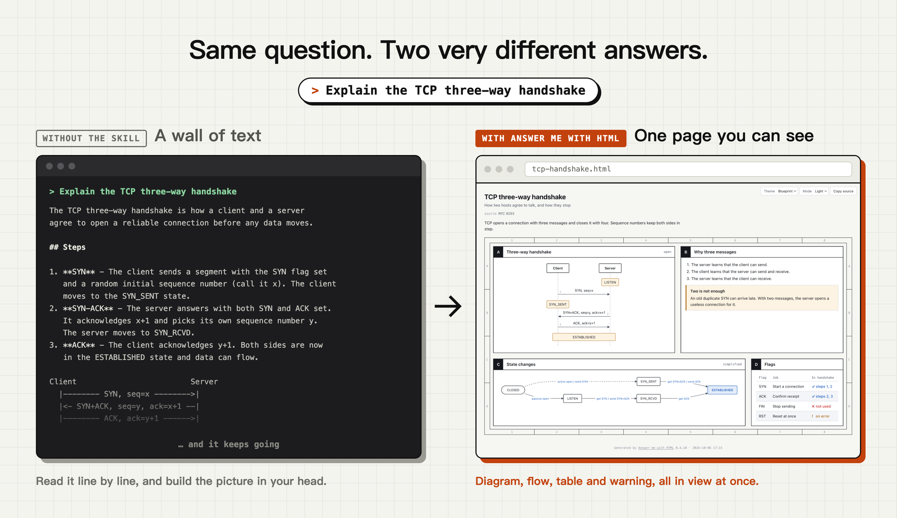

<p align="center">
  
</p>

<h1 align="center">Answer me with HTML</h1>

<p align="center">
  <b>超高速&nbsp;&nbsp;|&nbsp;&nbsp;ASD-STE100&nbsp;&nbsp;|&nbsp;&nbsp;解説動画&nbsp;&nbsp;|&nbsp;&nbsp;1 ファイル・オフライン</b>
</p>


<p align="center">
  
</p>

<p align="center">
  <b>エージェントスキルです。難しい質問をすると、テキストの壁ではなく、ちゃんと読めるページが返ってきます。<br>モデルが書くトークンは、HTML を手書きする場合の約 1/8 です。</b>
</p>

<p align="center">
  <a href="https://github.com/QingYunA/answer-me-with-html/releases"></a>
  <a href="https://github.com/QingYunA/answer-me-with-html/stargazers"></a>
  
  <a href="https://www.theagenticleaderboard.com/alternatives/answer-me-with-html/"></a>
  <a href="https://ko-fi.com/yunqing_love"></a>
  <a href="https://afdian.com/a/cyan_yunchen"></a>
</p>

<p align="center">
  <a href="https://answer-me-with-html.com/"><b>Web サイト</b></a> · <a href="#インストール">インストール</a> · <a href="#質問すると返ってくるもの">例</a> · <a href="#解説動画">動画</a> · <a href="#常時モード推奨">常時モード</a> · <a href="docs/reference.md">リファレンス</a> · <a href="README.md">English</a> · <a href="README.zh-CN.md">简体中文</a>
</p>

インストールしたら、いつもどおりに質問してください。

```
> Explain the TCP three-way handshake
> Map out how the modules in this repo fit together
> Redis or Memcached for our cache?
```

エージェントが短い Markdown の下書きを書き、スキルに同梱された CLI に渡します。約 50 ms 後には、ページができあがります。

https://github.com/user-attachments/assets/d3063a28-5dfd-4c44-a562-be901c49b249

<p align="center"><sub>24 秒のデモです。音をオンにすると音楽が流れます。</sub></p>

## HTML を直接頼めばいいのでは？

それもできます。最近のモデルは、そこそこの HTML を書けます。しかし、モデルが書くものの大半は内容ではありません。モデルが手書きした 9 ページのトークンを数えたところ、平均 4,893 トークンでした。

| ページの部分 | 割合 | このスキルを使うと |
| :--- | ---: | :--- |
| SVG の図：座標とパス | 47% | CLI が書きます |
| CSS | 15% | CLI が書きます |
| HTML タグ | 17% | CLI が書きます |
| テキスト | 21% | モデルが Markdown で書きます |

このスキルを使うと、モデルが書くのは Markdown の下書きだけです。同じ質問で平均 612 トークンで、**手書きの HTML の約 1/8** でした。書く量が減れば、待つ時間も減ります（3 トピック × 3 回の中央値、Claude Sonnet 5.5、素の Claude Code の環境）。

| | HTML を直接頼む | Answer me with HTML | |
| :--- | ---: | ---: | :--- |
| モデルが書くトークン | 4,893 | **612** | **8 分の 1** |
| 時間 | 31 s | **12 s** | **2.6 倍速い** |

<p align="center">
  
</p>

<p align="center"><sub>同じ質問に、同じモデルが 2 つの方法で答えたものです。どちらのページも使えます。</sub></p>

トークン数は [bench/corpus/tokens.json](bench/corpus/tokens.json) に保存されているので、`node bench/corpus.mjs` を実行すると毎回同じ数字が得られます。ページそのものは[ダウンロード](https://github.com/QingYunA/answer-me-with-html/releases/download/v0.4.14/bench-corpus-2026-10-07.zip)できます。料金は書く量ほどには下がらず、ここでは約 15% です。スキルの有無にかかわらず、毎ターンでシステムプロンプト、あなたの質問、会話も読み込むためです。[コストの内訳](bench/README.md#where-the-cost-goes)をご覧ください。

解説動画では、さらに節約できます。[小さなテスト](bench/README.md#explainer-videos)では、出力トークンが約 18 分の 1、速さは約 12 倍でした。

## インストール

[Node.js](https://nodejs.org/) 20 以降が必要です。`npm install` の手順はありません。CLI はスキルの中に同梱されています。まだ Node.js がない場合は、以下のおすすめの方法でインストールすれば、エージェントがあなたに確認してからインストールします。

### エージェントにインストールしてもらう（おすすめ）

これを Claude Code、Codex、Cursor、OpenCode などのエージェントに貼り付けてください。

> Answer me with HTML をインストールして：https://raw.githubusercontent.com/QingYunA/answer-me-with-html/main/INSTALL.md を読んで、その手順に従ってください。

[INSTALL.md](INSTALL.md) はエージェント向けに書かれています。Claude Code にはプラグインを、ほかのエージェントにはスキルをインストールし、既存のインストールはそのまま残します。Node.js がないか 20 より古い場合を除いて、あなたには何も尋ねず、最後に TCP の 3 ウェイハンドシェイクのページで結果を確認してから、報告を 1 回行います。エージェントがリンクを開けない場合は、`npx -y skills add QingYunA/answer-me-with-html -g -y -a <your agent name>` を使ってください（Claude Code の場合は `-a claude-code`）。

### Claude Code のプラグイン

Claude Code の中で次を実行します。

```
/plugin marketplace add QingYunA/answer-me-with-html
/plugin install answer-me-with-html@answer-me-with-html
```

### DeepSeek Harness のプラグイン

使っているプロファイル（同梱されているのは `web`）を指定して、ターミナルで次を実行します。

```bash
dsh plugin --profile web add github:QingYunA/answer-me-with-html
```

### 1 コマンドで

```bash
npx skills add QingYunA/answer-me-with-html
```

どのエージェントにインストールするかを尋ねられます。インストーラーの [vercel-labs/skills](https://github.com/vercel-labs/skills) は 70 以上のエージェントに対応しています。

<details>
<summary>手動でのインストール</summary>

`skills/answer-me-with-html` フォルダーを、エージェントのスキルフォルダーにコピーします。Claude Code の場合：

```bash
git clone --depth 1 https://github.com/QingYunA/answer-me-with-html.git /tmp/answer-me-with-html
cp -R /tmp/answer-me-with-html/skills/answer-me-with-html ~/.claude/skills/answer-me-with-html
```

ほかのエージェントのスキルフォルダー：Codex は `~/.codex/skills/`、Cursor は `~/.cursor/skills/`、OpenCode は `~/.config/opencode/skill/` です。

</details>

インストール後の設定は不要です。**[常時モード](#常時モード推奨)をオンにすることをおすすめします**。そうすると、難しい質問だけでなく、すべての結論にエージェントがページを添えるようになります。必要なのは、ルールファイルに 1 つのルールを書くことだけです。

## 質問すると返ってくるもの

| 質問 | 返ってくるもの |
| :--- | :--- |
| 「TCP の 3 ウェイハンドシェイクを説明して」 | シーケンス図、状態遷移図、フラグの表 |
| 「このリポジトリのモジュールはどう構成されている？」 | フォルダーツリーとコールグラフ |
| 「Redis と Memcached、どっち？」 | ✓ と ✗ の比較表と、その結論 |
| 「この段落の何がまずい？」 | 文ごとの注釈、問題のある語と修正案 |
| 「Kubernetes はどうやって生まれたの？」 | 重要な出来事を強調した年表 |
| 「キャッシュの変更を計画して」 | あなたのファイルの実際のコードと、ページ上で答える選択肢としての未決事項 |
| 「`ls` で隠しファイルを表示するには？」 | ページなし。1 行の質問には 1 行で答えます |

ページにする価値があるかどうかは、エージェントが判断します。関連する概念、複数ステップの流れ、多方面の比較などです。「HTML で説明して」と言うだけでもかまいません。

ページは `~/.answer-me-with-html/pages/` に保存されます。右上のボタンで、テーマとライト / ダークモードの切り替え、あなたの返信の取りまとめ、ページの元になった Markdown のコピーができます。

## Archify や GenUI プラグインとは何が違うのか？

[Archify](https://github.com/tt-a1i/archify) は、JSON の仕様から 1 つのインタラクティブな図を作ります。[dsh-genui](https://github.com/omdsh-dev/dsh-genui) のような GenUI プラグインは、1 つのチャットアプリの中にコンポーネントを表示します。このスキルは、テキスト、表、コード、図を含む 1 つのページとして、Markdown の下書きから質問全体に答えます。シェルコマンドを実行できるエージェントなら、どれでも動きます。[詳しい比較](docs/compare.md)をご覧ください。

## 解説動画

LLM の出力を理解するための Karpathy のはしごは、解説動画で終わります。3Blue1Brown のスタイルで頼んでみてください：「TCP ハンドシェイクについて 3b1b スタイルの動画を作って」。

<p align="center"></p>

エージェントは、ページの場合と同じ種類の下書きに加えて、ビートごとに 1 行のナレーションを書きます。それ以外は何もありません。

````markdown
## Both sides wait
```sequence
Client -> Server: SYN
Server -> Client: SYN-ACK
```
> The client sends a SYN to ask for a connection.
> The [Server] answers with a SYN-ACK.
````

`am video` がこれをプレーヤーのページに変換します。図はナレーションに合わせて一歩ずつ組み上がり、カメラは角かっこで名前を示したノードを追います。音声はページの中にあるので、オフラインでも再生できます。プレーヤーには、シーンの間を移動するチャプターストリップ、速度ボタン、ブラウザーの中で動画をエンコードしてダウンロードするエクスポートボタン（ローカルファイルまたは `localhost`、ffmpeg は不要）があります。MP4 ファイルが欲しい場合は `--mp4`（ffmpeg が必要）を、ページが自分でエンコードする WebM ファイルが欲しい場合は `--webm`（ffmpeg は不要）を追加します。エージェントが動画を作るのは、あなたが頼んだときだけです。詳しくは[動画ガイド](docs/video.md)をご覧ください。

## 設定

設定はスラッシュコマンドで変更します。手で編集する設定ファイルはありません。

| 場所 | 方法 |
| :--- | :--- |
| Claude Code（プラグインでのインストール） | `/answer-me-with-html:config` で何を変更するかを尋ねられます。`/answer-me-with-html:config open off` で直接変更します |
| すべてのエージェント | `/answer-me-with-html config open off`、または「ブラウザーを開かないで」と言うだけです |
| ターミナル | 表示は `am config`、変更は `am config set open off`、デフォルトに戻すには `am config reset` |

設定は `open`（ページをブラウザーで開く）、`theme`、`mode`（ライトまたはダーク）、`style`（文章チェック）、`scale`（ページの文字サイズ。図とグラフも合わせて大きくなります）、`update_check`、`close_after_reply`（返信をコピーしたらタブを閉じる）、`voice`（動画のナレーション）です。デフォルトと値：[リファレンス](docs/reference.md#settings)。

## 常時モード（推奨）

常時モードでは、**すべての結論にページが付きます**。エージェントが結論、要約、計画、比較を示すときは、短いものでも、2 ～ 4 個のパネルからなる小さなページを追加し、返信の最後にそのパスを置きます。これらのページが自動で開くことはないので、作業を邪魔しません。雑談や、結論のない返信はそのままです。Claude Code は、プランモードではページを作りません。

デフォルトではオフです。おすすめします。ページを頼む必要がなくなり、短い答えも長い答えと同じくらい読みやすくなります。ページは `~/.answer-me-with-html/` にたまっていくので、`am clean` で消してください。オンにするには、次の文をエージェントに貼り付けて、`~/.claude/CLAUDE.md` や `AGENTS.md` などのルールファイルにルールを書いてもらいます。

> Turn on always-on mode for Answer me with HTML: add a global rule — "[answer-me-with-html always-on] Whenever a reply gives a conclusion, summary, plan, comparison, review or explanation, even a short one, also make a page with the answer-me-with-html skill (2 to 4 panels for routine answers), render it with --no-open before you write the reply, and end the reply with the page link in the format SKILL.md specifies for your host. Skip casual chat, one- or two-sentence replies with no conclusion, pure command output, and requests for plain text. An internal report to another agent is not a user reply: return the findings and evidence the parent asked for, and make no page unless the task explicitly asks for one."

オフにするには、そのルールを削除します。ページの数を減らしたい場合は、[控えめにする](docs/reference.md#less-proactive)をご覧ください。

## 更新と後片付け

更新は手動です。CLI は使われたときに、バックグラウンドで GitHub の新しいバージョンを 1 日に 1 回まで確認します。新しいバージョンがあれば、エージェントに 3 日に 1 回まで知らせます。あなたに関する情報は何も送信されません。更新するには、エージェントに「answer-me-with-html を更新して」と伝えます。ページは `~/.answer-me-with-html/` にたまっていきます。「ページを片付けて」と言えば、エージェントは何かを削除する前に確認します。ほかのインストール方法とすべてのオプション：[リファレンス](docs/reference.md#updating-and-cleaning-up)。

## 背景

Andrej Karpathy は、LLM がより多くの仕事をこなすようになるにつれ、その出力についていくことが難しくなると[投稿しました](https://x.com/karpathy/status/2105819303471976479)。図や Web ページは、長いテキストのかたまりよりもずっと頭に入りやすいものです。

私はエージェントに直接 HTML で答えるよう頼んでみました。ページは良いものでしたが、遅かったのです。まともなページに 1 ～ 2 分かかり、その大半は毎回ほとんど同じ数百行の CSS でした。図はさらにひどいものでした。モデルは SVG の座標を手で計算しなければならず、矢印が何もない場所を指していることもよくありました。

そこで Answer me with HTML は、その作業をモデルから取り除きます。モデルは内容を書きます。レイアウト、色、描画は CLI が担当します。

## しくみ

モデルが書くのは、これだけです。

````markdown
---
title: TCP three-way handshake
---
## A Three-way handshake {span=2}
```sequence num
Client -> Server: SYN, seq=x
Server -> Client: SYN+ACK, seq=y, ack=x+1
Client -> Server: ACK, ack=y+1
note Client, Server: ESTABLISHED
```

## C State changes {span=2}
```flow LR
(CLOSED) -> LISTEN: passive open
LISTEN -> SYN_RCVD: get SYN / send SYN+ACK
SYN_RCVD -> *ESTABLISHED: get ACK
```
````

残りは CLI が行います。テンプレートを選び、パネルを配置し、テーマを適用し、[dagre](https://github.com/dagrejs/dagre) でフローチャートをレイアウトし、ラベルの幅に合わせてシーケンス図の間隔を決めます。下書きの全体である [examples/tcp.en.md](examples/tcp.en.md) は、次のページになります。

<p align="center">
  
</p>

## 機能

- **コードによるレイアウト：** パネルの配置と図の座標は、推測ではなく計算されます。ラベルが切れることも、グリッドに隙間ができることもありません。
- **自分の間違いを直す：** 下書きにエラーがあると、CLI は行番号、コンポーネント、正しい例を返します。エージェントは 1 回で修正できます。
- **3 つのテーマ：** `blueprint` は設計図のような見た目、`shadcn` はすっきりしたカード、`paper` は長文を読むための設定です。デフォルトでは、CLI は長いテキストには paper を、図には blueprint を選びます。どれもライトとダークのモードがあり、自分のテーマを追加したり、[テーマカタログ](https://answer-me-with-html.com/themes/)から選んだりもできます。
- **1 ファイル、依存なし：** 各ページは CDN のリンクも Web フォントもない、1 つの `.html` です。オフラインで開け、共有も簡単です。
- **言語：** 中国語（簡体字と繁体字）、英語、日本語は、それぞれ専用のボタンとフォントを持ちます。ほかの言語は英語のボタンで動作します。[言語](docs/reference.md#languages)をご覧ください。
- **文章チェック：** 下書きは、ASD-STE100 をもとにしたルールでチェックされます。長い文、冗長な言い回し、受動態などです。strict モードを指定しない限り、警告するだけです。
- **打ち直しではなく本物のコード：** コードブロックはあなたのファイルの行を引用できる（`src=` `lines=`）ので、ページ上のコードは本物のコードです。フォルダーの外のファイルや、鍵を含むファイルは拒否されます。
- **ページ上で答える：** どのパネルにもコメントでき、エージェントが尋ねる決定（`ask`）では選択肢を選べます。「返信」ボタンで、あなたの回答とコメントが、エージェントに貼り戻すための 1 つのメッセージにまとまります。
- **ソースを保持：** どのページにも、それを作った Markdown が埋め込まれています。「原稿をコピー」をクリックすると取り出せます。

<table>
  <tr>
    <td width="50%"></td>
    <td width="50%"></td>
  </tr>
  <tr>
    <td align="center"><sub>Blueprint テーマ（<a href="examples/ste100.md">examples/ste100.md</a>）</sub></td>
    <td align="center"><sub>shadcn テーマ、ダークモード</sub></td>
  </tr>
</table>

## コンポーネント

エージェントは、情報の形に合わせてコンポーネントを選びます。

| コンポーネント | 向いているもの |
| :--- | :--- |
| `flow` | アーキテクチャ、呼び出しの連鎖、判断の分岐。グループ、判断、データベースを含む自動レイアウト |
| `state` | 状態機械：状態と、それを切り替えるイベント。初期状態、終了状態、自己遷移に対応 |
| `er` | データモデル：列（PK / FK / UK）を持つエンティティと、鳥の足記法のリレーションシップ |
| `class` | UML クラス：属性、メソッド、インターフェース、リレーションシップ |
| `api` | HTTP / RPC の契約：パラメーター、リクエストとレスポンスのフィールド、ステータスコード |
| `sequence` | 複数の当事者の間で、時間とともにやりとりされるメッセージ |
| `tree` | フォルダー、モジュール、分類 |
| `timeline` | 歴史、リリース、フェーズ |
| `limits` | 上限に対する値 |
| `chart` | 数値の表から作る棒、折れ線、円グラフ：複数の系列、負の値、強調する行 |
| `annot` | 文に対する語ごとの注釈 |
| `kv` | メタデータ、図面の表題欄 |
| `callout` | 結論、ヒント、警告 |
| `ask` | ページ上であなたが行う決定。エージェントの提案にはタグが付き、最初は何も選択されていません |
| コードブロック | ファイルから引用した本物のコード（`src=` `lines=`）、またはスケッチ |
| 表 | 多方面の比較。セルに `ok` / `no` / `warn` と書くと ✓ ✗ ! になります。表の後に `{table sort filter}` を追加すると、インタラクティブに並べ替えと絞り込みができます |

下書きの形式（frontmatter、`span`、`rows`、生の `html` / `svg` ブロック）と、エージェントなしで CLI を呼ぶ方法は、[リファレンス](docs/reference.md)にあります。コンポーネントの完全な構文：`am help <component>`。

## STE の文章チェック

[ASD-STE100](https://www.asd-ste100.org/) は、もともと航空機の整備マニュアルのために使われた、制限された英語の形式です。そのルールは具体的です。文を短くする、各語に 1 つの意味を持たせる、手順は命令形で書く、などです。Karpathy は、LLM にこれらのルールに従うよう頼むと、その文章がずっと読みやすくなると述べています。

レンダリングのたびに、機械でチェックできる部分をチェックします。文の長さ、平易な語、受動態、よくある中国語の誤字やあいまいな語です。デフォルトでは警告するだけです。チェックに通らない下書きを拒否するには `/answer-me-with-html:config style strict` を設定するか、1 つの下書きで `style:` を指定します。ルールの一覧：[リファレンス](docs/reference.md#writing-check)。

## 開発

```bash
git clone https://github.com/QingYunA/answer-me-with-html.git && cd answer-me-with-html
npm install
npm test          # run the tests
AM_E2E=1 npm test # also run end-to-end video tests (system TTS, Chrome, ffmpeg)
npm run smoke:install # install for real with npx skills and validate the plugin manifests (needs network)
npm run build     # after changing src/, rebuild skills/answer-me-with-html/scripts/am.mjs
npm run snapshot  # compare rendered HTML with origin/main (refactors must not change it)
```

メンテナー向けの規約（生成されるバンドル、ページの形式、スナップショットのチェック、PR のレビュー、リリース）は [CONTRIBUTING.md](CONTRIBUTING.md) にあります。

実行時の依存関係は 2 つです。[marked](https://github.com/markedjs/marked) が Markdown をパースし、[@dagrejs/dagre](https://github.com/dagrejs/dagre) がフローチャートをレイアウトします。どちらも `am.mjs` にバンドルされています。

## コミュニティ

質問、作ったページの共有、機能の提案、ちょっとしたあいさつなど、なんでもどうぞ。

- [Discord](https://discord.gg/sYQuRRZNzQ)
- QQ グループ：`1127099407`
- [LINUX DO](https://linux.do)、中国語の開発者フォーラム
- [AtomGit](https://atomgit.com/weixin_43367137/answer-me-with-html)

バグを見つけたら、[GitHub issue](https://github.com/QingYunA/answer-me-with-html/issues) を作成してください。

## Star History

<a href="https://star-history.com/#QingYunA/answer-me-with-html&Date">
  <picture>
    <source media="(prefers-color-scheme: dark)" srcset="https://api.star-history.com/svg?repos=QingYunA/answer-me-with-html&type=Date&theme=dark" />
    <source media="(prefers-color-scheme: light)" srcset="https://api.star-history.com/svg?repos=QingYunA/answer-me-with-html&type=Date" />
    
  </picture>
</a>

## ライセンス

[MIT](LICENSE)。テーマが埋め込める Bangers フォントは [SIL Open Font License 1.1](skills/answer-me-with-html/licenses/OFL-Bangers.txt) のもとで提供されています。
